  

# David Kufeld

Front-end developer. I build websites and serious games with Nuxt, Vue and GSAP — where every movement has a purpose, and a response.

Based in Bordeaux · open to Paris, Amsterdam, Copenhagen, London, Montréal and remote · [davidkufeld.com](https://davidkufeld.com)

### Selected work

- **[L'Odyssée de Bot-B](https://www.odyssee-de-bot-b.fr/)** — narrative escape game · FWA of the Day, CSSDA · front-end and audio integration
- **[Fine Cover](https://fine-cover.fr/)** — brand website · full front-end and Payload CMS design
- **[Cannelle Thélise](https://cannellethelise.com)** · **[Khaula Bena](https://khaulabena.com/)** — portfolios for independent creatives · Nuxt, Sanity, GSAP
- **[davidkufeld.com](https://davidkufeld.com)** — my portfolio · custom page transitions, GSAP, performance and accessibility work

### Now

- Looking for a front-end role in a creative studio
- Learning Three.js and GLSL

### Stack

HTML · CSS · JavaScript · Nuxt · Vue · Vite · GSAP · Sass · Payload · Sanity · Git

### Before code

Design studies, then ten years composing music as Hollow Mountains. Design taught me to care about details; music taught me timing.

[LinkedIn](https://www.linkedin.com/in/davidkufeld/) · [Portfolio](https://davidkufeld.com)
